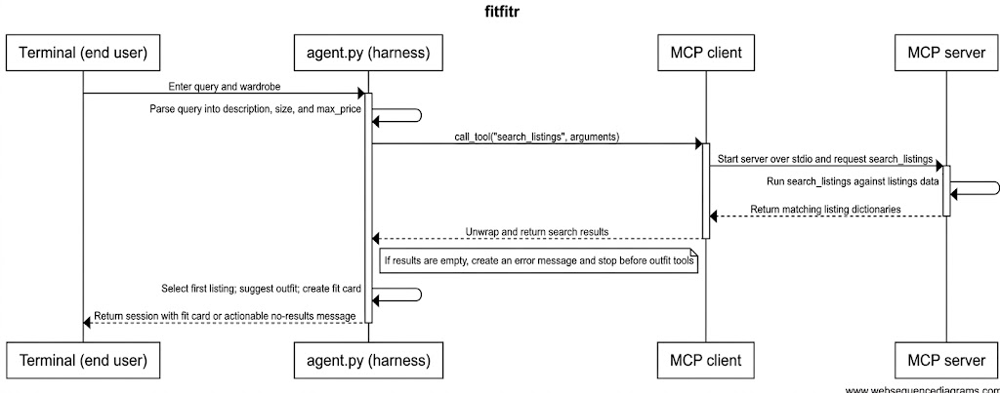

# FitFindr

> ### 👋 Start here
>
> **New to this repo? Read [RUNNING.md](RUNNING.md) first** — setup, every
> command, and what to do when something breaks.
>
> Once `python test.py` passes:
>
> ```bash
> python app.py listings --full -n 6      # read the data (Milestone 1)
> python app.py fields                    # what you can filter on
> python app.py ask 'vintage graphic tee under $30'
> ```
>
> All three tools are stubs, so that last command will do nothing useful yet.
> That's the starting position.
>
> **The rest of this file is your submission.** Fill it in as you go.

---

<!-- ─────────────────────────────────────────────────────────────────────────
     HOW TO USE THIS FILE

     This is your submission. Fill each section in as you finish the milestone
     it belongs to — don't leave it all to the end.

     Unit 3 asks for the first five sections. Unit 4 adds the five below them.
     Leave the unit 4 sections alone until then; they're here so you know
     what's coming.

     Everything is pasted as TEXT. No screenshots, no images, no video links.
     A typed block of output gets full credit; a picture of the same output
     gets none.
     ───────────────────────────────────────────────────────────────────────── -->

<!-- ═══════════════════════ UNIT 3 — THE BUILD ═══════════════════════ -->

## What This Does
<!-- Three or four sentences: what a user asks for, and what they get back. -->
A user types a plain-language thrifting request, like `"vintage graphic tee under $30"`, into `python app.py ask`. FitFindr pulls a description, a size, and a price ceiling out of that request, searches a mock listings dataset for the best match, and — if it found one — asks a language model to suggest an outfit pairing the item with pieces from the user's own wardrobe and to write a short, caption-style "fit card" naming the item, its price, and the platform it's on. If nothing in the dataset matches what was asked for, it stops immediately with a message naming what to change (the price ceiling, the size, or the keywords) instead of guessing at an outfit for an item that doesn't exist.

---

## Tool Inventory
<!-- Four lines per tool. This is worth 2 points and it's the single most common place students lose them. "Returns a list" earns NOTHING. The description has to say what is IN the list. The empty case isn't optional either — it's the thing your loop branches on, and if you don't decide it here you'll discover it as a crash in Milestone 5. 
     Ensure that name and type each: `max_price` (float), not "a price". -->
### Architectural Rationale: Specifying Tools Before Implementation

Defining the explicit interface contracts for `tools.py` before writing implementation code is essential because agent loops rely on deterministic return types to make control-flow decisions. When a tool returns ambiguous, poorly typed, or variable structures (such as returning `None` instead of `[]` on an empty search, or raising unhandled exceptions), the agent loop cannot branch reliably, resulting in unhandled exceptions or infinite execution loops. Establishing explicit function signatures, dictionary schemas, empty-state return values, and branching rules ensures that the agent can evaluate tool outputs programmatically without guessing.

### Tool Inventory: `search_listings`

- **What it does:** Search the dataset for thrift listings that match a keyword description, while applying optional size and price filters.
- **Inputs:** The inputs for `search_listings` are `description` of type `str` (required search keywords), `size` of type `str | None` (optional size string to filter by, defaulting to `None`), and `max_price` of type `float | None` (optional maximum price ceiling, inclusive, defaulting to `None`).
- **What it returns, specifically:** It returns a `list[dict]` containing at most `config.SEARCH_RESULT_LIMIT` listing dictionaries sorted in descending order by keyword match score. Each dictionary in the list contains the following fields: `id` (`str`), `title` (`str`), `description` (`str`), `category` (`str`), `style_tags` (`list[str]`), `size` (`str`), `condition` (`str`), `price` (`float`), `colors` (`list[str]`), `brand` (`str | None`), and `platform` (`str`).
- **What it returns when it has nothing to give:** It returns an empty list `[]` when no items match the filter criteria or score above zero, never returning `None` or raising an exception.

### Tool Inventory: `suggest_outfit`

- **What it does:** Suggest one or two outfit combinations by pairing a selected thrift item with pieces from the user's wardrobe using the language model.
- **Inputs:** The inputs for `suggest_outfit` are `new_item` of type `dict` (a single listing dictionary containing fields like `title`, `category`, `style_tags`, `colors`, and `brand`) and `wardrobe` of type `dict` (a dictionary containing an `'items'` key whose value is a list of wardrobe item dictionaries, each with `id`, `name`, `category`, `colors`, `style_tags`, and `notes`).
- **What it returns, specifically:** It returns a non-empty `str` containing model-generated outfit suggestions that explicitly reference specific clothing items owned by the user in their `wardrobe['items']` list.
- **What it returns when it has nothing to give:** When `wardrobe['items']` is an empty list, it returns a non-empty `str` containing general styling advice for `new_item` instead of returning `""` or raising an exception.

### Tool Inventory: `create_fit_card`

- **What it does:** Generate a short social media post caption for a thrift find based on an outfit recommendation and item details.
- **Inputs:** The inputs for `create_fit_card` are `outfit` of type `str` (the outfit suggestion text produced by `suggest_outfit`) and `new_item` of type `dict` (the listing dictionary for the target item).
- **What it returns, specifically:** It returns a `str` containing a two-to-four sentence caption written like an authentic social media post that mentions `new_item['title']`, `new_item['price']`, `new_item['platform']` once each, and captures the specific aesthetic vibe of the find.
- **What it returns when it has nothing to give:** If `outfit` is empty or consists only of whitespace, it returns a descriptive fallback `str` message stating that an outfit pairing was missing, rather than raising an exception or returning an empty string.

---

### Agent Loop Branching Rule

If `search_listings` returns an empty list, put a message in the session and stop. Otherwise, take the first result and go to `suggest_outfit`.

---

### Specification Audit

Could someone else build these tools from what was written without asking any questions? Yes, because every function contract explicitly specifies exact Python primitive and container types, full dictionary schema keys, boundary filtering behavior (such as non-substring size matching and max price inclusivity), empty-state default returns, and explicit fallback execution paths for LLM prompts.

---

### Milestone Commitment

All three tools in `tools.py` now have fully typed inputs, explicitly specified return structures down to individual dictionary fields, deterministic empty-state return rules, and a locked control-flow rule for the agent loop.

---

## Planning Loop
<!-- Your branch rule, stated as a rule — the condition AND both paths — plus the file and function that holds it.
     Like this:
       "If search_listings returns an empty list, put a message in the session
        and stop. Otherwise take the first result and go to suggest_outfit."
        — agent.py::run_agent
     The grader checks your code against what you claim here, so the file and function have to be real. -->

**Branch rule:** If `search_listings` returns an empty list, put a message in `session["error"]` naming what the user could change (price ceiling, size, or keywords) and return immediately — do not call `suggest_outfit`. Otherwise, take `search_results[0]` as `session["selected_item"]` and continue on to `suggest_outfit` and then `create_fit_card`.

**Where it lives:** `agent.py::run_agent`

**How the query is parsed:** Regex, in `agent.py::_parse_query`. A price-cue pattern (`under`/`below`/`less than`/`max` followed by an optional `$` and a number) or a bare `$NN` sets `max_price`; an explicit `"size X"` phrase, or failing that a standalone size token (`XXS`/`XS`/`S`/`M`/`L`/`XL`/`XXL`), sets `size`; whatever words are left after stripping those phrases and filler words (`"looking for"`, `"a"`, `"under"`, etc.) become the `description` keywords passed to `search_listings`.

**What moves through the session:** `query` → `parsed` (`description`, `size`, `max_price`) → `search_results` → `selected_item` (first result) → `outfit_suggestion` → `fit_card`. Each tool call reads its inputs back out of the session dict at the call site rather than from a carried-over local variable, so `session["selected_item"]` is provably the same object `suggest_outfit` and `create_fit_card` receive (verified with an `is` check — see Loop Trace).

---

## Sample Run
<!-- Two things go here.
     1. One FULL query and its output, pasted as text.
     2. Your three per-tool terminal tests — the command and what it printed. -->

**One full query**
```
$ python app.py ask 'vintage graphic tee under $30'
```
Terminal Output: 
```
     Found:    Y2K Baby Tee — Butterfly Print — $18.0 on depop

     Outfit:   Here are two outfit suggestions that combine the new Y2K Butterfly Baby Tee with pieces from your existing wardrobe, blending its nostalgic, feminine vibe with your streetwear and minimal staples:

     ### Outfit 1: 2000s Streetwear Contrast
     * **Top:** Y2K Baby Tee — Butterfly Print
     * **Bottoms:** Baggy straight-leg jeans, dark wash
     * **Outerwear:** Vintage black denim jacket *(worn open)*
     * **Shoes:** Chunky white sneakers
     * **Accessories:** Black crossbody bag

     **Why it works:** The tight, fitted silhouette of the baby tee creates a great Y2K-authentic proportion contrast against your high-waisted, baggy dark-wash jeans. Adding the slightly cropped black denim jacket ties in the dark tones, while the chunky white sneakers echo the white in the graphic print to pull the whole look together.

     ---

     ### Outfit 2: Soft-Edged Earth Tones
     * **Top:** Y2K Baby Tee — Butterfly Print
     * **Bottoms:** Wide-leg khaki trousers
     * **Accessories:** Brown leather belt

     **Why it works:** This look leans into the "cottagecore meets Y2K" tag by mixing the pink and purple butterfly print with the warm, minimal earth tones of your khaki trousers. Tucking the fitted baby tee into the high-waisted wide-leg trousers (accentuated with your brown leather belt) creates a clean, balanced silhouette that feels a bit more grounded and mature.

     Fit card: Found the ultimate early 2000s butterfly tee on depop for just $18, and I am officially ready to channel my inner pop princess. The pink and purple graphic print is giving major Limited Too nostalgia, so obviously I'm pairing it with baggy low-rise jeans. It's in mint condition, which honestly feels like a minor thrift miracle.

     2 model calls this session, 742 prompt + 383 output tokens
```

**The three tools, tested one at a time**

### Testing Tool 1 (search_listings): 

```
$ python -c "from tools import search_listings; print(search_listings('graphic tee', max_price=30))"
```
Terminal Output: 
```
[{'id': 'lst_002', 'title': 'Y2K Baby Tee — Butterfly Print', 'description': 'Super cute early 2000s baby tee with butterfly graphic. Fitted crop length. Tag says medium but fits like a small.', 'category': 'tops', 'style_tags': ['y2k', 'vintage', 'graphic tee', 'cottagecore'], 'size': 'S/M', 'condition': 'excellent', 'price': 18.0, 'colors': ['white', 'pink', 'purple'], 'brand': None, 'platform': 'depop'}, {'id': 'lst_006', 'title': 'Graphic Tee — 2003 Tour Bootleg Style', 'description': 'Vintage-style bootleg tee with faded graphic. Slightly boxy fit. 100% cotton, soft and worn-in.', 'category': 'tops', 'style_tags': ['graphic tee', 'vintage', 'grunge', 'streetwear', 'band tee'], 'size': 'L', 'condition': 'good', 'price': 24.0, 'colors': ['black'], 'brand': None, 'platform': 'depop'}, {'id': 'lst_017', 'title': 'Mesh Long-Sleeve Top — Black', 'description': 'Sheer black mesh long-sleeve. Great for layering under a graphic tee or over a bralette. Stretchy material, fits true to size.', 'category': 'tops', 'style_tags': ['y2k', 'grunge', 'goth', 'layering'], 'size': 'S/M', 'condition': 'excellent', 'price': 15.0, 'colors': ['black'], 'brand': None, 'platform': 'depop'}, {'id': 'lst_033', 'title': 'Vintage Band Tee — Faded Grey', 'description': 'Faded grey band-style tee with distressed graphic. Crew neck. Fits boxy. Well-loved but no holes or major damage.', 'category': 'tops', 'style_tags': ['vintage', 'grunge', 'band tee', 'graphic tee', 'streetwear'], 'size': 'L', 'condition': 'fair', 'price': 19.0, 'colors': ['grey', 'charcoal'], 'brand': None, 'platform': 'depop'}, {'id': 'lst_011', 'title': 'Low-Rise Cargo Pants — Khaki', 'description': 'Y2K era low-rise cargo pants. Lots of pockets. Khaki color, slightly distressed at the hems. Great for layering with a long tee.', 'category': 'bottoms', 'style_tags': ['y2k', 'cargo', '2000s', 'streetwear'], 'size': 'W29', 'condition': 'fair', 'price': 27.0, 'colors': ['khaki', 'tan'], 'brand': None, 'platform': 'poshmark'}, {'id': 'lst_015', 'title': 'Vintage Graphic Hoodie — Faded Black', 'description': 'Faded black pullover hoodie with barely-visible vintage graphic on the chest. Cozy interior. Some pilling but adds to the worn-in look.', 'category': 'tops', 'style_tags': ['vintage', 'grunge', 'graphic', 'streetwear'], 'size': 'L', 'condition': 'fair', 'price': 26.0, 'colors': ['black', 'charcoal'], 'brand': None, 'platform': 'depop'}]
```

### Testing Tool 2 (suggest_outfit): 

```
$ python -c "from tools import suggest_outfit; ..."
```
```
     python -c "from tools import suggest_outfit; from utils.data_loader import get_example_wardrobe, load_listings; print(suggest_outfit(load_listings()[0], get_example_wardrobe()))"
```
Terminal Output: 
```
Here are two outfit suggestions that seamlessly integrate the vintage Levi's 501 jeans into their existing wardrobe:

### Outfit 1: Effortless Streetwear Casual
* **The Vibe:** Relaxed, balanced, and everyday-ready. 
* **The Look:** Pair the mid-wash Levi's 501s with the **White ribbed tank top** tucked in to define the waist. Layer the **Vintage black denim jacket** over top for a classic denim-on-denim look with contrasting washes. Finish the fit with the **Chunky white sneakers**, the **Brown leather belt**, and the **Black crossbody bag**. 

### Outfit 2: Cozy Contrast
* **The Vibe:** Comfortable proportions with a hint of grunge edge.
* **The Look:** Wear the Levi's 501s with the **Oversized grey crewneck sweatshirt**. Because the crewneck is very oversized and drops below the hip, doing a "half-tuck" into the front of the jeans will add shape while keeping that cozy, slouchyfeel. Pair with the **Black combat boots** to ground the look, accented by the **Brown leather belt** and the **Black crossbody bag**.
```

### Testing Tool 3 (create_fit_card): 

```
$ python -c "from tools import create_fit_card; ..."
```
```
     python -c "from tools import create_fit_card; from utils.data_loader import load_listings; print(create_fit_card('jeans and white sneakers', load_listings()[0]))"
```
Terminal Output: 
```
Found these broken-in vintage Levi's 501 jeans on Depop for $38 and my closet has never looked better. They have that 90s slouch that no brand-new pair can ever quite get right, so I'm styling them today with crisp white sneakers for running errands.
```

---

## How I Used AI
<!-- Two specific moments. What you asked, what came back, what you changed.
     "I used Claude to help me code" is not enough.
     "I gave Claude my search_listings spec. It returned None on no match instead of an empty list, so I changed it" is the level we want. -->

**Moment 1**

- *What I asked for:* I was getting `google.genai.errors.ClientError: 400 INVALID_ARGUMENT ... API key not valid` from `suggest_outfit`, and I told Claude my key in `.env` was active and correct, so I needed help troubleshooting further.
- *What came back:* Claude read the raw bytes of `.env` (masking the key values) rather than trusting my assumption, and found two problems: a second key was saved under the variable name `GEMINI_API_KEY1` instead of `GEMINI_API_KEY` — a typo that meant the app was still reading the old, rejected key — and both keys started with `AQ.Ab8RN6...` rather than the standard Google AI Studio `AIzaSy...` prefix, suggesting the wrong kind of credential had been copied in.
- *What I changed:* I went back to aistudio.google.com, copied the actual `AIzaSy...` API key, and replaced the `.env` file with a single correctly-named `GEMINI_API_KEY=` line instead of the two conflicting ones.

**Moment 2**

- *What I asked for:* I asked Claude to look at a Pylance error on `call_config["system_instruction"] = system` in `generate.py` and tell me how to fix it, since I wasn't sure if it was safe to ignore.
- *What came back:* Claude ran Pyright directly to confirm the exact error (`reportArgumentType` — `str` isn't assignable to `float`) rather than guessing, and explained why it happens: `call_config = {"temperature": temperature}` lets the type checker infer `dict[str, float]`, so assigning a `str` value into it on the next line is flagged, even though it runs fine at runtime.
- *What I changed:* I had Claude add an explicit type annotation, `call_config: dict[str, float | str] = {"temperature": temperature}`, and confirmed with a second Pyright run that it dropped to 0 errors without changing any runtime behavior.

**Moment 3 — unit 4**

- *What I asked for:* Move `search_listings` onto MCP (Milestone 1) — wire `mcp_server.py` and point `agent.py::run_agent` at it instead of calling the tool directly.
- *What came back:* Claude uncommented the `@mcp.tool()` registration and wrote the tool description from scratch rather than copying the docstring, then swapped the direct call in `run_agent()` for `mcp_client.call_tool(...)`. Before flipping the switch, it compared the MCP response against the direct call on the same input and confirmed the output was identical in shape and content, then re-ran both the happy path and the empty-search path end-to-end afterward to check nothing regressed.
- *What I changed:* Nothing to correct — the rewire worked on the first attempt. What I did take from this was that the verification step (compare-before-switching, not just "it ran without an error") is what actually earns the "did anything behave differently" claim in the README, rather than just asserting it.

**Moment 4 — unit 4**

- *What I asked for:* Call each of my 5 criteria MET or MISSED against the before run log, and diagnose every miss by step and mechanism (Milestone 4).
- *What came back:* All 5 came back MET on the raw pass count, but instead of stopping there, Claude separated which MET verdicts were architecturally guaranteed (criteria 2, 3, 5 — deterministic code branches that should never miss) from the two built around model variance (criteria 1, 4), where a clean 5/5 is weaker evidence. It surfaced one specific try — a fit card that said "thirty bucks" instead of "$30" — that I'd scored PASS, but that revealed criterion 4's wording never actually defined whether a spelled-out amount counts as "mentions the price."
- *What I changed:* I revised criterion 4 in `criteria.md` to require a numeral with a currency symbol, without deleting the original line, and in Milestone 5 changed `create_fit_card`'s prompt to explicitly require that format instead of leaving it to chance.

<!-- ═══════════════════════ UNIT 4 — THE TEST ═══════════════════════ -->
---

## Run Log — Before Improvements
<!-- Five criteria, five tries each, in this exact format.

     Five, because your criteria are written out of five. Mark each try PASS
     or FAIL, count the passes, and read that count against your target — a
     row targeting 4 of 5 with three PASS cells is MISSED (3/5).

     `python run_eval.py --label before` runs everything and writes the table
     into results/. Paste it here and fill in the verdicts. -->

| Criterion | Target | Try 1 | Try 2 | Try 3 | Try 4 | Try 5 | Verdict |
|---|---|---|---|---|---|---|---|
| 1. Matching query completes all three tools | 4 of 5 | PASS | PASS | PASS | PASS | PASS | MET (5/5) |
| 2. Impossible query stops before the second tool | 5 of 5 | PASS | PASS | PASS | PASS | PASS | MET (5/5) |
| 3. Selected item ID persists across tool calls | 5 of 5 | PASS | PASS | PASS | PASS | PASS | MET (5/5) |
| 4. Fit card contains required metadata and valid length | 4 of 5 | PASS | PASS | PASS | PASS | PASS | MET (5/5) |
| 5. Empty wardrobe triggers general styling advice | 5 of 5 | PASS | PASS | PASS | PASS | PASS | MET (5/5) |

Full 25-try log (5 scenarios × 5 tries, caching off): `results/run_2026-10-10_1840_before.md`, produced by `run_eval.py::main` calling `agent.py::run_agent` once per try.

**Real output, one try per criterion**, pasted as text, naming the file and function that produced it:

**Criterion 1** — produced by `agent.py::run_agent` (scenario "matching query completes", try 1):

```
[1] parse_query
      in:  vintage graphic tee under $30
      out: dict with keys: description, size, max_price
[2] search_listings (via MCP)
      in:  dict with keys: description, size, max_price
      out: 10 items: Y2K Baby Tee — Butterfly Print, Graphic Tee — 2003 Tour Bootleg Style, Vintage Band Tee — Faded Grey … +7 more
      →    branch: results found, continuing to suggest_outfit
[3] suggest_outfit
      in:  Y2K Baby Tee — Butterfly Print ($18.0, depop)
      out: Here are two outfit suggestions that pair the Y2K Butterfly Baby Tee with items already in your wardrobe, blen…
[4] create_fit_card
      in:  Here are two outfit suggestions that pair the Y2K Butterfly Baby Tee with items already in your wardrobe, blen…
      out: Found this absolute holy grail Y2K butterfly baby tee for just $18, and I’m already planning on throwing it on…

Fit card: Found this absolute holy grail Y2K butterfly baby tee for just $18, and I’m already planning on throwing it on with some baggy dark-wash denim and chunky sneakers for that off-duty model look. Seriously cannot believe my luck scoring this on depop today.
```

**Criterion 2** — produced by `agent.py::run_agent` (scenario "impossible query stops early", try 1):

```
[1] parse_query
      in:  designer ballgown size XXS under $5
      out: dict with keys: description, size, max_price
[2] search_listings (via MCP)
      in:  dict with keys: description, size, max_price
      out: [] (empty)
      →    branch: empty, stopping before suggest_outfit

- stopped early: yes — No listings matched. Try a higher price ceiling, a different size, or broader keywords in the description.
- selected_item: (none)
- search_results: 0
```

**Criterion 3** — produced by `agent.py::run_agent`, verified with a spy wrapped around `tools.py::suggest_outfit` and `tools.py::create_fit_card` to capture the literal `id` each one actually received (query: "90s track jacket in size M", all 5 tries shown since this is the exact evidence the criterion asks for):

```
Try 1: session.selected_item.id='lst_004'  suggest_outfit received='lst_004'  create_fit_card received='lst_004'  -> PASS
Try 2: session.selected_item.id='lst_004'  suggest_outfit received='lst_004'  create_fit_card received='lst_004'  -> PASS
Try 3: session.selected_item.id='lst_004'  suggest_outfit received='lst_004'  create_fit_card received='lst_004'  -> PASS
Try 4: session.selected_item.id='lst_004'  suggest_outfit received='lst_004'  create_fit_card received='lst_004'  -> PASS
Try 5: session.selected_item.id='lst_004'  suggest_outfit received='lst_004'  create_fit_card received='lst_004'  -> PASS
```

**Criterion 4** — produced by `tools.py::create_fit_card` (scenario "fit card has required metadata", try 1, item: `90s Silk Slip Dress — Floral, Midi Length`, $30.0, depop):

```
Manifesting 90s supermodel energy with this vintage floral silk slip dress I just scored on Depop for $30. It’s giving romantic cottagecore until you throw on a beat-up denim jacket and combat boots to tougunt it up. Honestly obsessed with how easy it is to dress down with an oversized crewneck for daytime.
```

3 sentences (within the 2–4 range); mentions the item ("silk slip dress"), the price ("$30"), and the platform ("Depop") once each.

**Criterion 5** — produced by `tools.py::suggest_outfit` (scenario "empty wardrobe gets general advice", try 1, wardrobe: `{"items": []}`):

```
A light-wash, cropped vintage denim jacket is one of the ultimate wardrobe workhorses. Because it has a lighter color palette and a cropped silhouette, it naturally draws the eye upward, creates definition at the waist, and brings an effortless, casual cool to an outfit. 

Since this is the very first piece in a brand-new digital wardrobe, here is some foundational styling advice to help build around it.

---

### 1. Silhouette Pairing (Proportions)
Because the jacket is **cropped**, it plays best with pieces that contrast or complement that cut:
*   **High-Waisted Bottoms:** High-waisted mom jeans, wide-leg trousers, cargo pants, or midi skirts are a match made in heaven. They meet the hem of the jacket (or sit just slightly under it), which elongates your legs and creates a balanced silhouette.
```

(truncated here — full text is 1,500+ characters of general styling advice in `results/run_2026-10-10_1840_before.md`, under "empty wardrobe gets general advice" → Try 1.) Non-empty, no error, no owned pieces referenced since there were none to reference.

---

## Verdicts and Diagnoses
<!-- MET or MISSED per criterion against LAST UNIT's target, plus a sentence on
     how you decided.

     Then, for every miss: which of the four places it happened — a tool, the
     loop's branch, the session, or the model's output — AND the mechanism.

     Not a diagnosis:  "The fit card was bad."
     A diagnosis:      "The fit card criterion missed on 2 of 5 items. Both had
                        an empty brand field. My prompt puts the brand in the
                        first sentence, so the card opened with a blank and read
                        like a fragment. The tool worked; the prompt assumed a
                        field that isn't always there."

     Look for a pattern. Three misses on the same tool is one problem, not
     three. -->

| # | Criterion | Target | Verdict | How I decided |
|---|---|---|---|---|
| 1 | Matching query completes all three tools | 4 of 5 | MET (5/5) | All 5 tries of `agent.py::run_agent` (scenario "matching query completes") ran `search_listings` → `suggest_outfit` → `create_fit_card` and returned a non-empty fit card — 5 passes against a 4-of-5 target, in `results/run_2026-10-10_1840_before.md`. |
| 2 | Impossible query stops before the second tool | 5 of 5 | MET (5/5) | All 5 tries set `session["error"]` to a message naming what to change (price/size/keywords), and the run log's model-call count was 0 for every try — `suggest_outfit` never ran. 5/5 against a 5-of-5 target. |
| 3 | Selected item ID persists across tool calls | 5 of 5 | MET (5/5) | A spy wrapped around `tools.py::suggest_outfit` and `tools.py::create_fit_card` captured the literal `id` each one received across 5 independent runs; all 5 matched `session["selected_item"]["id"]` exactly (`lst_004` every time). 5/5. |
| 4 | Fit card contains required metadata and valid length | 4 of 5 | MET (5/5) | All 5 fit cards for the slip-dress item (`tools.py::create_fit_card`) were 2–3 sentences and named the item, a price, and the platform. 5/5 against a 4-of-5 target — see the note under Diagnoses below, though, before reading this as an unqualified win. |
| 5 | Empty wardrobe triggers general styling advice | 5 of 5 | MET (5/5) | All 5 tries with `wardrobe = {"items": []}` returned non-empty, item-specific advice from `tools.py::suggest_outfit`, named no owned pieces (there were none), and raised nothing. 5/5. |

**Diagnoses**

No criterion missed this run, so there's no step/mechanism to diagnose under the "tool, branch, session, or model output" rubric — that rubric is for explaining a failure, and this run didn't produce one. Saying "nothing missed" is not the same as saying "nothing to report," though, so here's the plain read instead of the comfortable one.

**Were the targets too low?** Not evenly. Criteria 2, 3, and 5 are all pinned to deterministic code — an `if not results:` branch, a dict assignment, an `if not wardrobe.get("items")` check — exactly as `criteria.md` already argues. A 5-of-5 result there isn't a cushion, it's the floor; anything less would mean an actual code defect, not a borderline case. I wouldn't tighten those.

Criteria 1 and 4 are the ones built around LLM variance, and both came back 5/5 against a 4-of-5 target — on paper, a clean win. But looking at *how* they were tested rather than just the score: criterion 1's scenario reused one easy, generously-matching query ("vintage graphic tee under $30") for all 5 tries, instead of 5 different phrasings. That query was never likely to miss on keyword overlap, so a 5/5 here mostly shows the test didn't stress the failure mode the target was written to anticipate — not that the agent is better than the target assumed. That's a scenario-design gap, not a target-leniency one, and I'm naming it rather than quietly taking the win.

Criterion 4 turned up something more concrete. Try 3 of "fit card has required metadata" read *"...on Depop for thirty bucks..."* instead of a numeral — see `results/run_2026-10-10_1840_before.md`, "fit card has required metadata" → Try 3. I counted it PASS, because "thirty bucks" unambiguously communicates the price. But the criterion as written — *"explicitly mentions the item's... price"* — never actually says whether a spelled-out amount satisfies that. A different, stricter grader could have called the same output a FAIL, and the criterion gives no way to settle it. That's not a target that was too loose; it's a target that couldn't be scored the same way twice, which is exactly the failure mode `criteria.md`'s own guidance warns about. **This is the criterion I'd tighten** — revised below, original left in place.

---

## Loop Trace
<!-- One full run, printed step by step, with the MCP call visible in it.
          `python app.py ask '...' --trace` 
     once you've added the trace.step() 
     calls in Milestone 2.
     Worth pasting BOTH the happy path and the empty-search path. The empty
     one should be visibly shorter, because it stops. If your two traces are
     the same length, your branch isn't working — and this is the fastest way
     anyone will ever find that out. -->

**Happy path**
Test Command Used:
```
$env:AI201_CACHE = "0"; python app.py ask 'vintage graphic tee under $30' --trace
```
Terminal Output:
```
     [1] parse_query
          in:  vintage graphic tee under $30
          out: dict with keys: description, size, max_price
     [2] search_listings
          in:  dict with keys: description, size, max_price
          out: 10 items: Y2K Baby Tee — Butterfly Print, Graphic Tee — 2003 Tour Bootleg Style, Vintage Band Tee — Faded Grey … +7 more
          →    branch: results found, continuing to suggest_outfit
     [3] suggest_outfit
          in:  Y2K Baby Tee — Butterfly Print ($18.0, depop)
          out: Here are two ways to style the **Y2K Baby Tee — Butterfly Print** using pieces already in your wardrobe:  ### …
     [4] create_fit_card
          in:  Here are two ways to style the **Y2K Baby Tee — Butterfly Print** using pieces already in your wardrobe:  ### …
          out: Found this absolute dream of a butterfly print Y2K baby tee while digging through the racks, and she can be yo…

     Found:    Y2K Baby Tee — Butterfly Print — $18.0 on depop

     Outfit:   Here are two ways to style the **Y2K Baby Tee — Butterfly Print** using pieces already in your wardrobe:

     ### Outfit 1: 2000s Streetwear Contrast
     * **Top:** Y2K Baby Tee — Butterfly Print
     * **Bottoms:** Baggy straight-leg jeans (dark blue/indigo)
     * **Shoes:** Chunky white sneakers
     * **Outerwear:** Vintage black denim jacket (slightly cropped)
     * **Accessories:** Black crossbody bag

     **Why it works:** The tight, cropped fit of the baby tee balances out the volume of your baggy, high-waisted dark wash jeans, nailing that classic Y2K silhouette. Layering the slightly cropped black denim jacket on top adds a bit of edge and ties in the streetwear vibe, while the chunky white sneakers keep the lower half feeling balanced and grounded. 

     ### Outfit 2: Casual Earth-Tone Mix
     * **Top:** Y2K Baby Tee — Butterfly Print
     * **Bottoms:** Wide-leg khaki trousers 
     * **Shoes:** Chunky white sneakers
     * **Accessories:** Brown leather belt, Black crossbody bag

     **Why it works:** This look leans into a fun high-low mix by pairing the ultra-feminine, pastel butterfly print with relaxed, minimalist khaki trousers. Tucking the fitted baby tee into the high-waisted trousers highlights your waist (you can accent this with your brown leather belt), and finishing the outfit with chunky white sneakers keeps it effortless and wearable for everyday.

     Fit card: Found this absolute dream of a butterfly print Y2K baby tee while digging through the racks, and she can be yours on depop for just $18. The pink and purple pastels give major 2000s mall-rat energy, especially paired with baggy low-rise denim and chunky kicks. Grab it before I change my mind and keep it for myself!

     2 model calls this session, 746 prompt + 388 output tokens
```
Sample of a Full Session Dump: 
```
     === HAPPY PATH ===
     --- full session dump ---
     {'error': None,
     'fit_card': 'Picked up this pastel butterfly baby tee on depop for just $18, '
               'and it’s honestly giving peak 2000s mallrat energy in the best '
               'way possible. I’m already planning to balance out the tiny fit '
               'by pairing it with my baggiest low-rise denim and chunky '
               "sneakers. It’s in mint condition and I'm obsessed with how the "
               'purple graphics pop against the white cotton.',
     'outfit_suggestion': 'Here are two outfit suggestions that pair the Y2K '
                         'Butterfly Baby Tee with pieces from your existing '
                         'wardrobe, blending its nostalgic, girly vibe with your '
                         'streetwear and minimal staples:\n'
                         '\n'
                         '### Outfit 1: 2000s Streetwear Contrast\n'
                         '* **Bottoms:** Baggy straight-leg jeans (dark '
                         'blue/indigo)\n'
                         '* **Shoes:** Chunky white sneakers\n'
                         '* **Accessories:** Black crossbody bag, brown leather '
                         'belt\n'
                         '* **Why it works:** The Y2K aesthetic thrives on '
                         'silhouette contrast. Pairing the ultra-fitted, cropped '
                         'baby tee with your high-waisted, baggy dark-wash jeans '
                         'nails the quintessential early-2000s look. The chunky '
                         'white sneakers tie into the white of the tee, while the '
                         'brown belt adds a subtle touch of contrast at the '
                         'waist. \n'
                         '\n'
                         '### Outfit 2: Edgy Casual Layering\n'
                         '* **Outerwear:** Vintage black denim jacket\n'
                         '* **Bottoms:** Wide-leg khaki trousers (khaki/tan)\n'
                         '* **Shoes:** Black combat boots\n'
                         '* **Accessories:** Black crossbody bag\n'
                         '* **Why it works:** This look leans into a mix of '
                         'cottagecore sweetness and grunge edge. Tucking the '
                         'butterfly tee into the wide-leg khaki trousers keeps '
                         'the proportions sharp, while throwing on the slightly '
                         'cropped black denim jacket and black combat boots '
                         'grounds the pastel pink and purple graphic print with a '
                         'tougher, grounded finish.',
     'parsed': {'description': 'vintage graphic tee',
               'max_price': 30.0,
               'size': None},
     'query': 'looking for a vintage graphic tee under $30',
     'search_results': [{'brand': None,
                         'category': 'tops',
                         'colors': ['white', 'pink', 'purple'],
                         'condition': 'excellent',
                         'description': 'Super cute early 2000s baby tee with '
                                        'butterfly graphic. Fitted crop length. '
                                        'Tag says medium but fits like a small.',
                         'id': 'lst_002',
                         'platform': 'depop',
                         'price': 18.0,
                         'size': 'S/M',
                         'style_tags': ['y2k',
                                        'vintage',
                                        'graphic tee',
                                        'cottagecore'],
                         'title': 'Y2K Baby Tee — Butterfly Print'},
                         {'brand': None,
                         'category': 'tops',
                         'colors': ['black'],
                         'condition': 'good',
                         'description': 'Vintage-style bootleg tee with faded '
                                        'graphic. Slightly boxy fit. 100% cotton, '
                                        'soft and worn-in.',
                         'id': 'lst_006',
                         'platform': 'depop',
                         'price': 24.0,
                         'size': 'L',
                         'style_tags': ['graphic tee',
                                        'vintage',
                                        'grunge',
                                        'streetwear',
                                        'band tee'],
                         'title': 'Graphic Tee — 2003 Tour Bootleg Style'},
                         {'brand': None,
                         'category': 'tops',
                         'colors': ['grey', 'charcoal'],
                         'condition': 'fair',
                         'description': 'Faded grey band-style tee with distressed '
                                        'graphic. Crew neck. Fits boxy. Well-loved '
                                        'but no holes or major damage.',
                         'id': 'lst_033',
                         'platform': 'depop',
                         'price': 19.0,
                         'size': 'L',
                         'style_tags': ['vintage',
                                        'grunge',
                                        'band tee',
                                        'graphic tee',
                                        'streetwear'],
                         'title': 'Vintage Band Tee — Faded Grey'},
                         {'brand': None,
                         'category': 'tops',
                         'colors': ['black', 'charcoal'],
                         'condition': 'fair',
                         'description': 'Faded black pullover hoodie with '
                                        'barely-visible vintage graphic on the '
                                        'chest. Cozy interior. Some pilling but '
                                        'adds to the worn-in look.',
                         'id': 'lst_015',
                         'platform': 'depop',
                         'price': 26.0,
                         'size': 'L',
                         'style_tags': ['vintage',
                                        'grunge',
                                        'graphic',
                                        'streetwear'],
                         'title': 'Vintage Graphic Hoodie — Faded Black'},
                         {'brand': None,
                         'category': 'tops',
                         'colors': ['black'],
                         'condition': 'excellent',
                         'description': 'Sheer black mesh long-sleeve. Great for '
                                        'layering under a graphic tee or over a '
                                        'bralette. Stretchy material, fits true to '
                                        'size.',
                         'id': 'lst_017',
                         'platform': 'depop',
                         'price': 15.0,
                         'size': 'S/M',
                         'style_tags': ['y2k', 'grunge', 'goth', 'layering'],
                         'title': 'Mesh Long-Sleeve Top — Black'},
                         {'brand': 'Woolrich',
                         'category': 'tops',
                         'colors': ['red', 'black'],
                         'condition': 'good',
                         'description': 'Classic oversized flannel. Great layering '
                                        'piece. A few tiny pulls in the fabric but '
                                        'nothing visible when worn.',
                         'id': 'lst_003',
                         'platform': 'thredUp',
                         'price': 22.0,
                         'size': 'XL (oversized)',
                         'style_tags': ['grunge',
                                        'vintage',
                                        'flannel',
                                        'streetwear',
                                        'layering'],
                         'title': 'Oversized Flannel Shirt — Plaid Red/Black'},
                         {'brand': None,
                         'category': 'bottoms',
                         'colors': ['khaki', 'tan'],
                         'condition': 'fair',
                         'description': 'Y2K era low-rise cargo pants. Lots of '
                                        'pockets. Khaki color, slightly distressed '
                                        'at the hems. Great for layering with a '
                                        'long tee.',
                         'id': 'lst_011',
                         'platform': 'poshmark',
                         'price': 27.0,
                         'size': 'W29',
                         'style_tags': ['y2k', 'cargo', '2000s', 'streetwear'],
                         'title': 'Low-Rise Cargo Pants — Khaki'},
                         {'brand': None,
                         'category': 'tops',
                         'colors': ['navy'],
                         'condition': 'good',
                         'description': 'Perfectly faded navy crewneck. Genuinely '
                                        'vintage — not manufactured distressed. '
                                        'Ribbed cuffs and hem. No graphics, clean.',
                         'id': 'lst_012',
                         'platform': 'thredUp',
                         'price': 20.0,
                         'size': 'XL (fits oversized)',
                         'style_tags': ['vintage',
                                        'basics',
                                        'oversized',
                                        'classic'],
                         'title': 'Oversized Crewneck Sweatshirt — Vintage Navy'},
                         {'brand': None,
                         'category': 'bottoms',
                         'colors': ['ivory', 'dusty pink', 'green'],
                         'condition': 'good',
                         'description': 'Delicate 90s slip dress in a muted floral '
                                        'print. Midi length, adjustable straps. '
                                        'Light snag on the side seam — not visible '
                                        'when worn.',
                         'id': 'lst_013',
                         'platform': 'depop',
                         'price': 30.0,
                         'size': 'M',
                         'style_tags': ['90s',
                                        'vintage',
                                        'feminine',
                                        'floral',
                                        'cottagecore'],
                         'title': '90s Silk Slip Dress — Floral, Midi Length'},
                         {'brand': None,
                         'category': 'accessories',
                         'colors': ['brown'],
                         'condition': 'excellent',
                         'description': 'Genuine leather braided belt. Adjustable, '
                                        'multiple holes. Classic Western buckle. '
                                        'Can be dressed up or down.',
                         'id': 'lst_014',
                         'platform': 'thredUp',
                         'price': 12.0,
                         'size': 'One Size (adjustable)',
                         'style_tags': ['vintage',
                                        'western',
                                        'classic',
                                        'earth tones'],
                         'title': 'Leather Belt — Brown, Braided'}],
     'selected_item': {'brand': None,
                    'category': 'tops',
                    'colors': ['white', 'pink', 'purple'],
                    'condition': 'excellent',
                    'description': 'Super cute early 2000s baby tee with '
                                   'butterfly graphic. Fitted crop length. Tag '
                                   'says medium but fits like a small.',
                    'id': 'lst_002',
                    'platform': 'depop',
                    'price': 18.0,
                    'size': 'S/M',
                    'style_tags': ['y2k',
                                   'vintage',
                                   'graphic tee',
                                   'cottagecore'],
                    'title': 'Y2K Baby Tee — Butterfly Print'},
     'wardrobe': {'items': [{'category': 'bottoms',
                              'colors': ['dark blue', 'indigo'],
                              'id': 'w_001',
                              'name': 'Baggy straight-leg jeans, dark wash',
                              'notes': 'High-waisted, sits above the hip',
                              'style_tags': ['denim', 'streetwear', 'baggy']},
                         {'category': 'bottoms',
                              'colors': ['khaki', 'tan'],
                              'id': 'w_002',
                              'name': 'Wide-leg khaki trousers',
                              'notes': None,
                              'style_tags': ['earth tones', 'minimal', 'wide-leg']},
                         {'category': 'tops',
                              'colors': ['white'],
                              'id': 'w_003',
                              'name': 'White ribbed tank top',
                              'notes': 'Goes with everything',
                              'style_tags': ['basics', 'minimal', 'fitted']},
                         {'category': 'tops',
                              'colors': ['grey', 'charcoal'],
                              'id': 'w_004',
                              'name': 'Oversized grey crewneck sweatshirt',
                              'notes': 'Really oversized — drops below the hip',
                              'style_tags': ['oversized', 'basics', 'cozy']},
                         {'category': 'tops',
                              'colors': ['black'],
                              'id': 'w_005',
                              'name': 'Black cropped zip hoodie',
                              'notes': None,
                              'style_tags': ['athletic', 'streetwear', 'cropped']},
                         {'category': 'outerwear',
                              'colors': ['black'],
                              'id': 'w_006',
                              'name': 'Vintage black denim jacket',
                              'notes': 'Slightly cropped',
                              'style_tags': ['denim', 'vintage', 'classic']},
                         {'category': 'shoes',
                              'colors': ['white'],
                              'id': 'w_007',
                              'name': 'Chunky white sneakers',
                              'notes': None,
                              'style_tags': ['sneakers', 'chunky', 'streetwear']},
                         {'category': 'shoes',
                              'colors': ['black'],
                              'id': 'w_008',
                              'name': 'Black combat boots',
                              'notes': 'Lace-up, mid-ankle height',
                              'style_tags': ['boots', 'grunge', 'classic']},
                         {'category': 'accessories',
                              'colors': ['brown'],
                              'id': 'w_009',
                              'name': 'Brown leather belt',
                              'notes': None,
                              'style_tags': ['classic',
                                             'earth tones',
                                             'accessories']},
                         {'category': 'accessories',
                              'colors': ['black'],
                              'id': 'w_010',
                              'name': 'Black crossbody bag',
                              'notes': None,
                              'style_tags': ['minimal',
                                             'accessories',
                                             'everyday']}]}}

     Same object identity (session[selected_item] is new_item passed to suggest_outfit): True
     item id in session: lst_002
     item id passed to suggest_outfit: lst_002
```

**Empty search**
Test Command Used:
```
$env:AI201_CACHE = "0"; python app.py ask 'designer ballgown size XXS under $5' --trace
```
Terminal Output:
```
     [1] parse_query
          in:  designer ballgown size XXS under $5
          out: dict with keys: description, size, max_price
     [2] search_listings
          in:  dict with keys: description, size, max_price
          out: [] (empty)
          →    branch: empty, stopping before suggest_outfit

     No listings matched. Try a higher price ceiling, a different size, or broader keywords in the description.

     0 model calls this session
```
Sample of Full Session Dump:
```
     === IMPOSSIBLE QUERY ===
     parsed: {'description': 'designer ballgown', 'size': 'XXS', 'max_price': 5.0}
     search_results: []
     selected_item: None
     outfit_suggestion: None
     fit_card: None
     error: No listings matched. Try a higher price ceiling, a different size, or broader keywords in the description.

     suggest_outfit was called: False
     create_fit_card was called: False
```

**On the MCP move:** 
<!-- what changed in your code, and whether anything behaved differently afterwards. If the rewire didn't work, say exactly where it broke — the error text and the last thing that worked. That earns the point in full. -->
`search_listings` is now served over MCP instead of called directly. Three changes:

1. **`mcp_server.py`** — uncommented the `@mcp.tool()` registration and wrote the description from scratch (not copied from the docstring), naming units (`max_price` in whole or fractional US dollars), the non-substring size-matching behavior, and the empty-list return explicitly, since this description is read by an agent that can't see `tools.py`.
2. **`agent.py`** — removed the direct `from tools import search_listings` import and swapped the call in `run_agent()`:
   ```python
   session["search_results"] = call_tool("search_listings", {
       "description": session["parsed"]["description"],
       "size": session["parsed"]["size"],
       "max_price": session["parsed"]["max_price"],
   })
   ```
3. **`trace.step()` label** — renamed the step from `"search_listings"` to `"search_listings (via MCP)"` so the move is visible in the Loop Trace, per `trace.py`'s own guidance.

**Did anything behave differently?** No. Before swapping the call in `run_agent()`, I compared the two directly:
```
via MCP, count: 6
direct call, count: 6
same shape (list of dicts): True
identical content: True
```
Then re-ran both the happy path and the empty-search path end to end through `python app.py ask ... --trace` — both produced the same results as before the rewire, just with `[2] search_listings (via MCP)` in place of `[2] search_listings` in the trace. The rewire worked on the first attempt; no failure to document here.

**Update, Milestone 6:** the two full `run_eval.py` passes (before and after) called `search_listings` over MCP 25 times each — 50 subprocess round-trips total, each one starting the server fresh, per `mcp_client.py`'s own design — with zero MCP-related failures across either run. That's more exercise than the original single-call comparison got, and it held up. One gap this surfaced, though: `run_agent()` only wraps `suggest_outfit` and `create_fit_card` in a `try/except ModelUnavailable` (see Failure Handling below) — the `call_tool("search_listings", ...)` line has no equivalent handler, so if the MCP server failed to start or `mcp_client.py` raised `MCPError`, it would still crash out of `run_agent()` unhandled, the same way a bad API key used to. It never happened in 50 calls, but "never happened yet" isn't the same as "handled." Named in What's Still Broken below rather than fixed here, since it wasn't the failure Milestone 5's diagnosis pointed at.

### Failure Handling

Of the three failure modes tested, only **model unavailable** actually crashed — empty search and empty wardrobe already returned clean messages/advice with no handler needed.

**What I added:** `agent.py::run_agent` now wraps both model-calling tool calls — `suggest_outfit` and `create_fit_card` — in `try/except ModelUnavailable`. On that exception, `session["error"]` is set to the exception's own message (built in `generate.py::_explain`, e.g. *"The model rejected your API key. Check GEMINI_API_KEY in your .env file, or create a fresh key at aistudio.google.com."*) and `run_agent` returns immediately — the same stop-the-session pattern already used for the empty-search branch, instead of letting the exception propagate.

**Before:** a bad key crashed out of `run_agent()` entirely. The only reason a CLI user never saw a raw stack trace was `app.py::main()`'s generic top-level `except Exception` catch — a caller using `run_agent()` directly (not through `app.py`) got an unhandled exception and no usable session.

**After**, verified by corrupting one character of `GEMINI_API_KEY` and re-running:
```
[3] suggest_outfit
      in:  Platform Sneakers — White Chunky Sole ($48.0, poshmark)
      →    branch: model unavailable, stopping before create_fit_card

  The model rejected your API key. Check GEMINI_API_KEY in your .env file, or create a fresh key at aistudio.google.com.

1 model calls this session
```
`session["error"]` is set to a message naming what broke (a rejected key) and what to do about it (check `.env`, or make a fresh key); `session["outfit_suggestion"]` and `session["fit_card"]` stay `None`; `run_agent` returns a normal session dict instead of raising. The key was restored immediately after this test.

### Loop Trace — full run, after the fix

```
$ python app.py ask 'vintage graphic tee under $30' --trace

[1] parse_query
      in:  vintage graphic tee under $30
      out: dict with keys: description, size, max_price
[2] search_listings (via MCP)
      in:  dict with keys: description, size, max_price
      out: 10 items: Y2K Baby Tee — Butterfly Print, Graphic Tee — 2003 Tour Bootleg Style, Vintage Band Tee — Faded Grey … +7 more
      →    branch: results found, continuing to suggest_outfit
[3] suggest_outfit
      in:  Y2K Baby Tee — Butterfly Print ($18.0, depop)
      out: Here are two ways to style the Y2K Butterfly Baby Tee using pieces already in your wardrobe:  ### Outfit 1: 20…
[4] create_fit_card
      in:  Here are two ways to style the Y2K Butterfly Baby Tee using pieces already in your wardrobe:  ### Outfit 1: 20…
      out: Found this sweet little butterfly tee for $18 on Depop and I'm obsessed with the pink and purple print. I've b…

  Found:    Y2K Baby Tee — Butterfly Print — $18.0 on depop

  Outfit:   Here are two ways to style the Y2K Butterfly Baby Tee using pieces already in your wardrobe:

### Outfit 1: 2000s Streetwear Contrast
* **Top:** Y2K Baby Tee — Butterfly Print
* **Bottoms:** Baggy straight-leg jeans (dark wash)
* **Outerwear:** Vintage black denim jacket
* **Shoes:** Chunky white sneakers
* **Accessories:** Black crossbody bag

**Why it works:** The tight, cropped fit of the baby tee creates a great silhouette when paired with high-waisted, baggy dark-wash jeans—a classic Y2K proportion trick. Layering the slightly cropped black denim jacket on top adds a bit of edge and ties in with the casual streetwear vibe of the chunky white sneakers. 

### Outfit 2: Casual Earth-Tone Mix
* **Top:** Y2K Baby Tee — Butterfly Print
* **Bottoms:** Wide-leg khaki trousers
* **Accessories:** Brown leather belt + Black crossbody bag
* **Shoes:** Black combat boots 

**Why it works:** This outfit blends the Y2K aesthetic of the tee with the minimal, earthy tones of your wide-leg trousers. Tucking in the baby tee and wearing the brown leather belt highlights your waist against the loose trousers. Finishing the look with black combat boots adds a subtle grunge contrast to the sweet pink and purple butterfly print.

  Fit card: Found this sweet little butterfly tee for $18 on Depop and I'm obsessed with the pink and purple print. I've been living in tiny baby tees lately because they look so good balanced out with baggy, low-slung denim. It's giving major Y2K mall rat energy in the best way possible.

2 model calls this session, 724 prompt + 357 output tokens
```

---

## The Improvement
<!-- What you changed, why your diagnosis pointed at it, and the after-run in
     the same table format. One change, measured properly.

     `python run_eval.py --label after` -->

**What I changed:** One line, in `tools.py::create_fit_card`'s prompt. Before:

> "Write 2 to 4 sentences. Mention the item, its price, and the platform each exactly once, and be specific about the vibe rather than generic."

After:

> "Write 2 to 4 sentences. Mention the item, its price as a numeral with a dollar sign exactly as given above (e.g. "$30" — never spelled out, like "thirty dollars" or "thirty bucks"), and the platform, each exactly once, and be specific about the vibe rather than generic."

Nothing else changed — not the loop, not the other two tools, not the scenarios.

**Which failure it was meant to fix:** The mechanism named in the Milestone 4 diagnosis and the revision to criterion 4 in `criteria.md`: Try 3 of "fit card has required metadata" in the before run wrote *"...on Depop for thirty bucks..."* instead of a numeral. The old prompt only said "mention... its price," never specifying the format, so the model was free to spell it out. The fix tells it explicitly what "mentions the price" has to look like.

### Run Log — After Improvements

| Criterion | Target | Try 1 | Try 2 | Try 3 | Try 4 | Try 5 | Verdict |
|---|---|---|---|---|---|---|---|
| 1. Matching query completes all three tools | 4 of 5 | PASS | PASS | PASS | PASS | PASS | MET (5/5) |
| 2. Impossible query stops before the second tool | 5 of 5 | PASS | PASS | PASS | PASS | PASS | MET (5/5) |
| 3. Selected item ID persists across tool calls | 5 of 5 | PASS | PASS | PASS | PASS | PASS | MET (5/5) |
| 4. Fit card contains required metadata and valid length *(revised wording)* | 4 of 5 | PASS | PASS | PASS | PASS | PASS | MET (5/5) |
| 5. Empty wardrobe triggers general styling advice | 5 of 5 | PASS | PASS | PASS | PASS | PASS | MET (5/5) |

Full log: `results/run_2026-10-10_1919_after.md`, produced the same way as the before log — `run_eval.py::main` calling `agent.py::run_agent`, caching off, 5 scenarios × 5 tries.

**Before vs. after, side by side, on the thing that actually changed** — the 5 fit cards from "fit card has required metadata" (same item, same query, both runs):

| | Before (`run_2026-10-10_1840_before.md`) | After (`run_2026-10-10_1919_after.md`) |
|---|---|---|
| Try 1 | "...I just scored on Depop for **$30**." | "...on depop for **$30**..." |
| Try 2 | "...off depop for **$30**..." | "...on depop for just **$30**..." |
| Try 3 | "...off Depop for **thirty bucks**..." ⚠️ | "...on depop for **$30**..." |
| Try 4 | "...on depop for just **$30**..." | "...on Depop for **$30**..." |
| Try 5 | "...on Depop for just **$30**..." | "...on depop for only **$30**..." |

I also spot-checked the fit cards from the other three scenarios that call `create_fit_card` (criteria 1, 3, and 5) in the after run — all 15 of those used a numeral price too (`$18.00`, `$45.00`, `$42.00`), so the fix generalized past the one scenario it was diagnosed from, not just the one I was staring at.

**Did it help, and how do I know:** Partially, and I want to be precise about what "helped" means here rather than round it up. Criterion 4's **verdict didn't move** — it was already MET (5/5) in the before run, because I'd scored "thirty bucks" as a PASS (it does communicate the price). What changed is the thing the diagnosis actually flagged: the *ambiguous* case is gone. Before: 1 of 5 fit cards used a spelled-out price that a stricter grader could have failed. After: 0 of 5 did, across both the targeted scenario and the other three I checked. So the fix did exactly what it was meant to do — it closed the gap between "the criterion technically passed" and "the criterion passed unambiguously" — but because the headline number was already 5/5, this run can't show a MISSED-to-MET flip to prove it. A test that could actually detect a regression here would need a stricter grading rule (reject non-numeral prices outright) rather than relying on my judgment calls when scoring PASS/FAIL by hand.

---

## What's Still Broken
<!-- For each criterion still missed: what you'd do, and why you stopped where
     you did. "I ran out of time" is fine if it's true. Pretending nothing is
     left is not. -->

No criterion is currently scored MISSED — both the before and after run logs read 5/5 across all five. That's a real result, not something to round down, but it isn't the same as "nothing left to do." Here's what's genuinely unresolved, named rather than swept under a clean scoreboard:

**1. Criterion 1's target has never actually been tested against the risk it names.** `criteria.md` sets 4 of 5 because plain keyword-overlap search can miss on phrasing or synonyms a user actually types — but the scenario for criterion 1 reuses one easy, generously-matching query ("vintage graphic tee under $30") for all 5 tries. A 5/5 here mostly proves that query is easy, not that the agent handles the harder phrasing the target was written to anticipate.
   - *What I'd do:* add one or two more scenarios to `scenarios.py` under criterion 1, deliberately using synonym-heavy or imprecise phrasing (e.g. wording that doesn't share dataset vocabulary) to see whether the 4-of-5 target actually gets exercised.
   - *Why I stopped there:* Milestone 5 was explicitly one change, and the diagnosis from Milestone 4 pointed at criterion 4's price-format ambiguity with concrete evidence (an actual try that said "thirty bucks"), not at criterion 1, which was a reasoning gap rather than an observed failure. I fixed the one I had evidence for.

**2. Criterion 4's fix is a prompt instruction, not a guarantee.** `create_fit_card` now tells the model to write the price as a numeral, and 20 of 20 fit cards across both the before-vs-after comparison and my spot-check followed it — but that's still the model choosing to comply, not code enforcing it. Nothing in `tools.py` would catch it if the model drifted back to "thirty bucks" on some future call.
   - *What I'd do:* add a lightweight regex check after `generate()` returns in `create_fit_card` — something like confirming `f"${new_item['price']:g}"` or an equivalent numeral pattern appears in the text — and either retry once or flag it, rather than trusting the instruction alone.
   - *Why I stopped there:* this is closer to "add a second branch" than "rewrite one prompt," and Milestone 5 asked for one change. I made the cheaper fix first since it had direct evidence behind it; the validation layer is the next one if a future run shows the prompt instruction alone isn't holding.

**3. `search_listings` has no failure handler, unlike the other two tools.** Covered in the MCP-move update above — `suggest_outfit` and `create_fit_card` are wrapped in `try/except ModelUnavailable`, but the `call_tool("search_listings", ...)` call isn't wrapped in anything. An `MCPError` (server won't start, tool not registered, a broken stdio pipe) would still crash `run_agent()` unhandled.
   - *What I'd do:* add a `try/except MCPError` around that call, mirroring the pattern already used for the model calls, setting `session["error"]` to something like "Couldn't reach the search tool — see mcp_client.py's error for how to check mcp_server.py on its own" and returning early.
   - *Why I stopped there:* it never happened — 50 MCP calls across both eval runs, zero failures — so there was no observed instance to diagnose, and none of my five criteria test this path. It's a real gap, just not one the data asked me to close yet.

**4. `trace.step()` prints on every `ask` call, not just when `--trace` is passed.** Noticed while running the failure-mode tests in Milestone 2 — because `trace.py::step()` calls `print()` unconditionally, every `run_agent()` call shows its trace, regardless of the CLI flag. Cosmetic only; it doesn't affect any criterion.
   - *What I'd do:* have `trace.step()` only print when a trace is actually active (e.g., track whether `start_trace()` was called this run) instead of always printing and only conditionally *capturing*.
   - *Why I stopped there:* out of scope for every milestone that came up — it was never the thing a diagnosis pointed at, just something I noticed in passing and kept meaning to flag rather than fix on the side.

<!-- ═════════════════════════════════════════════════════════════════════

     SUBMISSION CHECKLIST — unit 3

       [ ] criteria.md has five numbered criteria, each with a target
       [ ] Each criterion has a reason underneath it
       [ ] All five unit 3 sections above have real content
       [ ] Tool Inventory: all three tools, inputs WITH TYPES, a specific
           return value, and the empty case
       [ ] Planning Loop names the branch rule and agent.py::run_agent
       [ ] Sample Run: one full query plus the three per-tool tests, as text
       [ ] At least four new commits
       [ ] Repository URL submitted — WRITE IT DOWN, you submit the same one
           next unit

     SUBMISSION CHECKLIST — unit 4

       [ ] mcp_server.py exists with one tool registered
           (or a written record of exactly where the rewire broke)
       [ ] Run Log — Before, five criteria, five tries each
       [ ] Real output pasted underneath, naming file and function
       [ ] A verdict on every criterion
       [ ] A diagnosis for every miss, naming a place AND a mechanism
       [ ] Loop Trace, with the MCP call visible in it
       [ ] All three failure modes triggered and handled
       [ ] One improvement, with Run Log — After in the same format
       [ ] What's Still Broken
       [ ] At least four new commits
       [ ] The SAME repository URL as last unit

     Do not delete and recreate this repository. Your commit history is what
     shows your criteria existed before your results did.
     ═════════════════════════════════════════════════════════════════════ -->

---

📖 **How to run this project: [RUNNING.md](RUNNING.md)**

⛓️‍💥 **Web Sequence Diagram:** <br>


# FitFinder Architecture & Execution Flow

This section provides an architectural breakdown and sequence analysis of the **FitFinder** (`fitfitr`) agent application. Designed as a reference for the project **README**, this breakdown maps out the end-to-end request lifecycle, client-server decoupling, and tool-calling mechanics powered by FastMCP over `stdio` transport.

---

## 1. Architectural Components & Lifelines

The sequence diagram defines four primary participants across the system architecture:

* **`Terminal (end user)`**: The interactive entry point where the end user initiates the session by providing raw inputs (query and wardrobe data).
* **`agent.py (harness)`**: The central orchestration harness responsible for query parsing, agentic reasoning, state management, tool invocation delegation, and final response rendering.
* **`MCP client`**: The Model Context Protocol client layer that bridges the harness agent to the underlying MCP server infrastructure.
* **`MCP server`**: The backend server instance executing domain-specific logic and querying underlying data sources.

---

## 2. End-to-End Sequence Execution Flow
```
[Terminal (end user)] -> [agent.py (harness)] -> [MCP client] -> [MCP server]
```

### Phase 1: Ingestion & Query Parsing

1. **User Input**: The user inputs a query and wardrobe context into the terminal:
* *Message*: `Enter query and wardrobe`

2. **Harness Parsing**: `agent.py (harness)` processes the raw input string internally:
* *Operation*: `Parse query into description, size, and max_price`
* *Extracted Parameters*:
     * `description` (String)
     * `size` (String/Descriptor)
     * `max_price` (Numeric/Constraint)

### Phase 2: MCP Tool Invocation & Transport

3. **Tool Request**: The harness initiates a tool call via the MCP client:
* *Message*: `call_tool("search_listings", arguments)`
* *Target Tool Name*: `"search_listings"`
* *Payload*: `arguments` object containing the parsed parameters.

4. **Server Transport Initialization**: The MCP client bridges the call to the server:
* *Message*: `Start server over stdio and request search_listings`
* *Transport Mechanism*: Standard Input/Output (`stdio`).

### Phase 3: Server Execution & Data Retrieval

5. **Listings Lookup**: The `MCP server` executes the search logic against internal datasets:
* *Operation*: `Run search_listings against listings data`

6. **Data Return**: The server serializes and returns matching records back through the client:
* *Message*: `Return matching listing dictionaries` (returning structured listing data objects).
* *Harness Unwrapping*: `MCP client` unwraps the payload: `Unwrap and return search results`.

### Phase 4: Conditional Validation & Business Logic Guardrail

7. **Empty Results Guardrail**:
> **Note / Constraint (Explicitly Defined in Diagram):**
> *If results are empty, create an error message and stop before outfit tools.*

8. **Successful Path (Outfit Generation)**: If results are present, the harness proceeds with downstream execution:
* *Operation*: `Select first listing; suggest outfit; create fit card`

### Phase 5: Response Rendering

9. **Session Completion**: The harness returns the final compiled state to the user terminal:
* *Message*: `Return session with fit card or actionable no-results message`